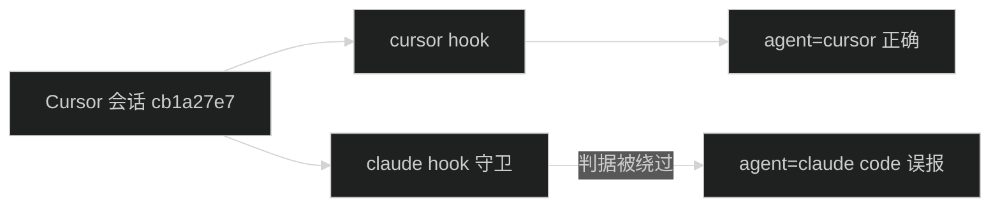

# Cursor 会话被误报为 Claude Code

> 状态：**待 review，尚未改动任何代码**
> 发现日期：2026-09-18
> 影响版本：v1.5.2（build 13）及当前 main
> 环境：Cursor 3.21.9 / Claude Code 2.1.274 / macOS

## 1. 现象

用户没有打开 Claude Code，但 Agent Signal Bar 的 session 列表里出现了 `claude-code` 条目，
并在当前 Agent Session 中与 `cursor` 混在一起显示。

状态文件 `/tmp/agent-signal/status.json` 的实际内容（节选）：

```json
{ "agent": "claude-code", "event": "PostToolUse:MCP:zspace_tree",
  "session_id": "cb1a27e7-4952-43fd-ba40-c5a6f30cb56d", "signal": "tool_done" }
{ "agent": "cursor",      "event": "ToolDone",
  "session_id": "cb1a27e7-4952-43fd-ba40-c5a6f30cb56d", "signal": "tool_done" }
```

按 `session_id` 归并后，同一个会话下挂着两个来源：

| agent | 事件数 | 事件名 |
| --- | --- | --- |
| `claude-code` | 16 | `PostToolUse:MCP:zspace_rename`(2)、`PreToolUse:MCP:zspace_rename`、`PreToolUse:MCP:zspace_tree`、`PostToolUse:MCP:zspace_tree`、`PreToolUse:Read`(2)、`PreToolUse:Write`(2)、`PostToolUse:Write`(2)、`PreToolUse:Shell`(2)、`PostToolUse:Shell`、`Stop`、`beforeSubmitPrompt` |
| `cursor` | 14 | `ToolDone`(4)、`Thinking`(6)、`PreToolUse`(3)、`AgentFinished` |

## 2. 证据链

### 2.1 决定性证据：两个来源共用一个 session_id

`claude-code` 与 `cursor` 的 `session_id` 完全相同，都是 `cb1a27e7-4952-43fd-ba40-c5a6f30cb56d`。

两个独立会话不可能撞出同一个 UUID。这说明是**同一个 Cursor 会话被上报了两次**：
一次经 Cursor 自己的 hook 正确上报为 `cursor`，一次经 `~/.claude/settings.json` 的 hook 误报为 `claude-code`。

两者 session_id 必然相同的原因是：Cursor 的 payload 里 `session_id` 与 `conversation_id` 同值
（见 `script/test_claude_code_signal_hook.py` 中 2026-09-10 抓到的真实样本），
而 Cursor 侧 hook `~/.cursor/hooks/agent-signal-bar.sh` 取 `conversation_id` 作为 session key。

### 2.2 工具名指向 Cursor，不是 Claude Code

- `MCP:zspace_tree` / `MCP:zspace_rename` — 对应 ps 中正在运行的
  `cursor-agent --worker-dir /Users/dawn80s/zspace-cli`（PID 39441）
- `Shell` — Cursor 风格工具名，Claude Code 用的是 `Bash`
- 带 `MCP:` 前缀的工具名也是 Cursor 的命名风格

### 2.3 `beforeSubmitPrompt` 是 Cursor 独有事件名

`claude-code` 的事件里混进了 `beforeSubmitPrompt`（camelCase）。Claude Code 从不发送这个事件名，
它出现在 `~/.cursor/hooks.json` 的 Cursor 事件体系里。

这条同时是一个**反向指示器**：它是 camelCase，本该被 hook 守卫拦下却放行了（见 3.2）。

### 2.4 Cursor 有独立且正常的上报通道

`~/.cursor/hooks.json` 注册了 `~/.cursor/hooks/agent-signal-bar.sh`，事件全部是 camelCase
（`sessionStart` / `preToolUse` / `postToolUse` / `stop` / `sessionEnd`），
脚本内部硬编码 `agent = "cursor"`，与状态文件里的 `cursor` 事件完全吻合。

结论：**即使拦掉 claude hook 侧的 Cursor payload，Cursor 的正常上报也不受影响。**

## 3. 根因

### 3.1 背景：钩子是跨客户端共享的

`~/.claude/settings.json` 里注册了 27 个事件，全部指向
`/Applications/AgentSignalLight.app/Contents/Resources/scripts/claude-code-signal-hook`。
Cursor 的 agent 兼容 Claude Code 的钩子协议，**同样会执行这些钩子**。

因此 hook 脚本必须在转发前判断"这次调用到底是不是 Claude Code 发起的"。

### 3.2 现有守卫的两条判据，在新版 Cursor 上双双失效

`scripts/claude-code-signal-hook:19-50` 的判据是：

```python
# 1. transcript_path 非空 → 放行
if text("transcript_path", "transcriptPath"):
    sys.exit(0)

# 2. 事件名首字母大写（PascalCase）→ 放行
event = text("hook_event_name", "event_name", "event", "hook", "type", "name")
if event and event[:1].isupper():
    sys.exit(0)
```

| 判据 | 当初的假设 | 现状 | 证据 |
| --- | --- | --- | --- |
| ① `transcript_path` 非空 | Cursor 传 `null` | **失效**：Cursor 也会带非空值 | camelCase 的 `beforeSubmitPrompt` 被上报了——判据② 拦不住它，只能是判据① 放行的 |
| ② 事件名 PascalCase | Cursor 用 camelCase | **失效**：新版 Cursor 混用 PascalCase | `PostToolUse:MCP:zspace_tree`、`PreToolUse:Shell`、`Stop` 全是大写开头 |

即 Cursor 3.21.9 的 payload 同时具备"PascalCase 事件名"和"非空 transcript_path"，
两条正向判据都被满足，于是被当成 Claude Code 转发。

### 3.3 已排除的假设

| 假设 | 判定 | 理由 |
| --- | --- | --- |
| H3：真的有 Claude Code 在跑，不是误报 | **排除** | ps 里确实有两个 `claude` 进程（PID 63139、34009），但真实 Claude 会话的 session_id 不可能与 Cursor 会话完全相同；且工具名 `MCP:zspace_*`、`Shell` 都是 Cursor 风格 |
| H4：环境变量 `CLAUDE_SESSION_ID` 污染 | **排除** | hook 脚本早已不读环境变量做判定；且状态里的 session_id 显式来自 payload |

### 3.4 双重上报路径



## 4. 修复方案

### 方案 A：负向排除 Cursor 专属字段（推荐）

在守卫最前面加一段：payload 里出现 Cursor 专属字段就直接丢弃，不再走正向判据。

依据：`script/test_claude_code_signal_hook.py:108-119` 固化的 2026-09-10 真实 Cursor payload 含
`cursor_version` / `composer_mode` / `conversation_id` / `workspace_roots` /
`is_background_agent` / `generation_id`，Claude Code 不会发送这些字段。

```python
# Cursor 专属字段：出现任一即判定为兼容客户端，不予上报。
# 注意用「键是否存在」判断，不能用真值判断：
# generation_id 实测为空字符串 ""，workspace_roots 为空数组 []。
CURSOR_ONLY_KEYS = ("cursor_version", "composer_mode", "workspace_roots",
                    "is_background_agent", "generation_id")
if any(key in payload for key in CURSOR_ONLY_KEYS):
    sys.exit(1)
```

优点：

- 不依赖"Cursor 的 transcript_path 一定为空"这类会被新版打破的假设
- 不影响真实 Claude Code（Claude 的 payload 不含这些字段）
- 只改 shell 脚本里的 python 片段，不动 Swift、不动状态结构

待 review 的两个取舍点：

1. **`conversation_id` 要不要放进排除列表。**
   它是最强的兜底（Cursor 必带），但 `ClaudeHookAdapter.sessionKey`
   （`HookAdapters.swift:286-292`）把 `conversation_id` 也当作合法的 session key 来源，
   说明设计上并未排除 Claude Code 使用它。建议**先不放**，保留现状，
   用 `cursor_version` 等 5 个字段已足够；若后续发现仍有漏网的 Cursor payload 再补。

2. **是否保留原来的两条正向判据。**
   建议保留，作为"负向排除 + 正向确认"的双保险，避免某些第三方兼容客户端
   既没有 Cursor 字段、又不是真 Claude 时被误放行。

### 方案 B：先抓真实 payload 再定方案

当前对"Curson 新版 payload 的确切字段"是**反推**出来的（依据事件名与工具名），
尚未实时抓包确认。若要求方案建立在实测数据上：

1. 在 `~/.claude/settings.json` 的任一事件下**追加**一个只写日志、不改行为的诊断 hook
2. 等 Cursor（或任意兼容客户端）触发一次
3. 从日志里确认 Cursor 3.21.9 究竟带了哪些字段、哪些是空值
4. 再据此定稿排除列表，然后撤掉诊断 hook

代价：需要改用户的 `~/.claude/settings.json`，且要等待一次真实触发。

### 方案 C：检测调用方进程

钩子进程由谁拉起，是最本质的判据：Claude Code 是 `claude` 的 node 进程，Cursor 是 Cursor 的进程树。
可在 hook 里用 `ps -o args= -p $PPID` 判断。

不推荐：依赖进程树结构，比依赖 payload 字段更脆弱，且每次触发都要多起一个进程。

## 5. 验证方式

### 5.1 复现脚本（已验证可复现）

`/tmp/repro_cursor_hook.py`（临时文件，未入库）用 Cursor 3.21.9 风格 payload 打 hook，
观察是否放行。当前结果：

```
case                                      放行(上报为claude)
----------------------------------------------------------
cursor 3.21.9 PreToolUse(MCP工具)                    True   ← 应为 False
cursor 3.21.9 PreToolUse(Shell)                      True   ← 应为 False
cursor 3.21.9 Stop                                   True   ← 应为 False
真实 Claude Code PreToolUse                          True
真实 Claude Code Stop(无transcript)                   True
```

前 3 行是 bug；修复后应变为 `False`，后 2 行必须保持 `True`。

### 5.2 回归测试

`script/test_claude_code_signal_hook.py` 现有 9 个用例，当前**全绿**——
因为它们都建立在"Cursor 只发 camelCase 且 transcript_path 为 null"的旧假设上，
覆盖不到本 bug。修复时需补充：

- Cursor PascalCase 事件 + 非空 transcript_path → 必须丢弃
- Cursor camelCase 事件 + 非空 transcript_path → 必须丢弃
- 真实 Claude payload → 仍须放行（防止改坏）

该测试是纯 Python + shell，不依赖 `swift test`（本机 `swift test` 因
SweetCookieKit 6.2 / XCTest 工具链问题跑不起来）。

## 6. 影响面

- **改动文件**：仅 `scripts/claude-code-signal-hook`（shell 脚本内的 python 守卫）
- **不改动**：Swift 源码、状态文件结构、Cursor 侧 hook
- **生效范围**：实际生效的是 `/Applications/AgentSignalLight.app/Contents/Resources/scripts/` 下那份
  （经 `diff` 确认，已安装版与源码当前完全一致）。源码改动后需重新安装 app 才能生效
- **副作用风险**：若排除列表过宽，可能漏报真实 Claude 事件。方案 A 用的 5 个字段
  Claude Code 均不发送，风险可控

## 7. 附：为什么"没有打开 Claude"这个直觉没错

状态文件里 `claude-code` 的 16 条事件，全部来自 Cursor 会话。用户的直觉是对的：
**确实没有一个 Claude 会话在产生这些事件**。

只是 ps 里同时存在两个 `claude` 进程（PID 63139 `claude --dangerously-skip-permissions`、
PID 34009 `claude`），排查时容易造成干扰。这两个进程与本次误报无关。
