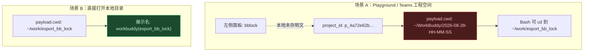
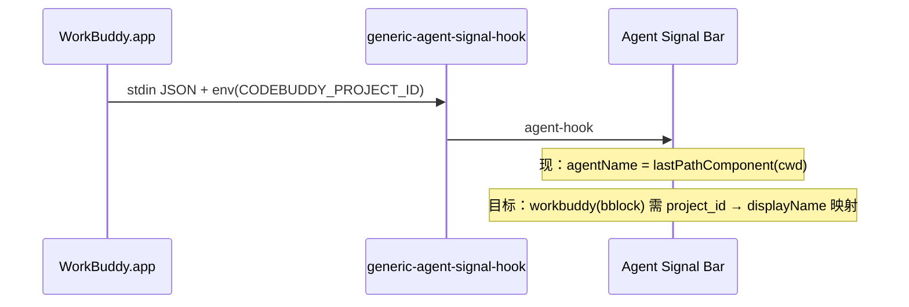

# WorkBuddy Hook Payload & cwd 形态调研

> Ticket: [#21 Catalogue real WorkBuddy hook payloads and cwd shapes](https://github.com/yangxy112683/Agent-Signal-Bar/issues/21)  
> 环境：WorkBuddy 5.4.4 / macOS / `~/.workbuddy/settings.json` generic hook  
> 采集时间：2026-08-28

## 结论摘要

| 来源 | 可用于展示名的字段 | 备注 |
|------|-------------------|------|
| **Hook payload** | `cwd`（唯一稳定路径线索） | **无** `project_id` / `workspace_name` / `project_title` |
| **Hook 环境变量** | `CODEBUDDY_PROJECT_ID` | Teams 工程空间 ID，如 `p_4a72e62b…`；**无**人类可读名 |
| **workbuddy.db** | `sessions.project_id`, `sessions.title` | `title` 是会话标题，不是左侧面板工程空间名 |
| **本地文件** | 未找到 `bblock` 等 display name 明文 | 工程空间展示名疑似云端 + `wb:workspaces:getDisplayNames` |

**核心缺口**：Playground 场景下 `payload.cwd` 永远是 timestamp 目录（`~/WorkBuddy/2026-08-28-HH-MM-SS`），即使用户在 Bash 里 `cd` 到真实仓库；`CODEBUDDY_PROJECT_ID` 在 env 里稳定存在，但当前 `GenericHookAdapter` 未读取。

---

## Hook 安装配置

`~/.workbuddy/settings.json` → 各事件均指向 `generic-agent-signal-hook`（无 `--agent`，透传原始 payload）：

- SessionStart, UserPromptSubmit, PreToolUse, PostToolUse
- Notification, Stop, PermissionRequest
- SubagentStart, SubagentStop, SessionEnd

---

## Payload 字段清单（实证）

### 所有事件共有字段（CodeBuddy 文档 + 实测）

```jsonc
{
  "session_id": "uuid",
  "transcript_path": "~/.workbuddy/projects/.../session.jsonl",
  "cwd": "/Users/.../WorkBuddy/2026-08-28-19-04-08",
  "permission_mode": "default | plan | acceptEdits | bypassPermissions",
  "hook_event_name": "PreToolUse | ..."
}
```

### WorkBuddy 5.4.4 实测额外字段（PreToolUse / PostToolUse）

```jsonc
{
  "tool_name": "Bash",
  "tool_input": { "command": "...", "description": "..." },
  "call_id": "call_00_...",
  "tool_use_id": "call_00_...",
  "agent_type": "cli",
  "client": "WorkBuddy",
  "version": "5.4.4",
  "generation_id": "2d18234857424d91ad29fccb3aa8f4f3",
  "model": "deepseek-v4-pro-ioa"
}
```

PostToolUse 另有 `tool_response`（exitCode、signal 等）。

**payload 中不存在**：`project_id`, `workspace`, `repository`, `project_name`, `workspace_name`, `agent`（仅有 `agent_type` + `client`）。

---

## 环境变量（hook 子进程）

### 与项目/会话相关的键（实测）

| 变量 | 示例值 | 说明 |
|------|--------|------|
| `CODEBUDDY_PROJECT_ID` | `p_4a72e62b48154560a5ce37551dbb4a9b` | Teams 工程空间 ID |
| `CODEBUDDY_PROJECT_DIR` | `~/WorkBuddy/2026-08-28-19-04-08` | 与 payload.cwd 一致 |
| `CLAUDE_PROJECT_DIR` | 同上 | 别名 |
| `CODEBUDDY_SESSION_SKILL_DIRS` | `~/.workbuddy/project-resources/p_4a72e62b…` | 按 project_id 分目录 |
| `CODEBUDDY_HOST` | `workbuddy-desktop` | 宿主标识 |
| `CLIENT_INFO_PLATFORM` | `WorkBuddy` | |
| `CLIENT_INFO_IDE_TYPE` | `WorkBuddy` | |
| `WORKBUDDY_APP_NAME` | `WorkBuddy` | `isWorkBuddyIDEHost` 检测用 |

完整列表见 sandbox 日志：`~/.workbuddy/logs/sandbox/20260828/sandbox_72883_000.log` 第 2 行。

---

## cwd 两种形态



### 场景 A — Timestamp Playground（主流）

| 字段 | 值 |
|------|-----|
| `sessions.cwd` | `/Users/dawn80s/WorkBuddy/2026-08-28-19-04-08` |
| `sessions.is_playground` | `1` |
| `sessions.project_id` | `p_4a72e62b48154560a5ce37551dbb4a9b` |
| `sessions.title` | `补充全过程记录文档内容`（AI 会话标题） |
| hook `payload.cwd` | 同上 timestamp 路径 |
| hook env `CODEBUDDY_PROJECT_ID` | `p_4a72e62b48154560a5ce37551dbb4a9b` |
| Bash `tool_input.command` | 可含 `cd /Users/dawn80s/work/esport_bb_lock && …` |

**当前 GenericHookAdapter 输出**：`workbuddy(2026-08-28-19-04-08)`

### 场景 B — cwd 指向真实仓库

当 WorkBuddy 直接以仓库为工作目录打开时：

| 字段 | 值 |
|------|-----|
| `payload.cwd` | `/Users/dawn80s/work/esport_bb_lock` |
| **当前输出** | `workbuddy(esport_bb_lock)` |

### 场景 C — CLI host 噪声（应忽略）

| 字段 | 值 |
|------|-----|
| `cwd` | 含 `__workbuddy_cli_host__` |
| **处理** | `shouldIgnoreHook` / `workbuddyProjectSessionKey` 过滤 |

---

## 真实 hook 样例

### 样例 1：PreToolUse（Bash，Playground cwd）

```json
{
  "session_id": "4ac1e0d0-5f0f-4720-8225-d608bdaaaad3",
  "cwd": "/Users/dawn80s/WorkBuddy/2026-08-28-19-04-08",
  "hook_event_name": "PreToolUse",
  "tool_name": "Bash",
  "tool_input": {
    "command": "cd /Users/dawn80s/work/esport_bb_lock && git log --oneline -30",
    "description": "查看 git 提交历史与当前状态"
  },
  "client": "WorkBuddy",
  "agent_type": "cli",
  "permission_mode": "bypassPermissions"
}
```

env: `CODEBUDDY_PROJECT_ID=p_4a72e62b48154560a5ce37551dbb4a9b`

### 样例 2：PostToolUse（同上会话）

同上字段 + `tool_response.exitCode: 0`。

### 样例 3：Notification（文档形状，模拟验证）

```json
{
  "session_id": "4ac1e0d0-…",
  "cwd": "/Users/dawn80s/WorkBuddy/2026-08-28-19-04-08",
  "hook_event_name": "Notification",
  "message": "CodeBuddy needs your permission to use Bash",
  "notification_type": "permission_prompt"
}
```

### 样例 4：SessionStart

```json
{
  "session_id": "4ac1e0d0-…",
  "cwd": "/Users/dawn80s/WorkBuddy/2026-08-28-19-04-08",
  "hook_event_name": "SessionStart",
  "source": "startup"
}
```

---

## workbuddy.db 交叉验证

```sql
-- sessions 表（节选）
id | project_id | cwd | is_playground | title
4ac1e0d0-… | p_4a72e62b… | ~/WorkBuddy/2026-08-28-19-04-08 | 1 | 补充全过程记录文档内容

-- workspaces 表仅记录最近打开的 path，无 display name
path | last_opened_at
/Users/dawn80s/WorkBuddy/Claw | 1778125364301
```

Transcript 中 Teams 上下文含 `<tdrive-root dir_name="p_4a72e62b…" scope="project" />`，但不含 `bblock`。

---

## 数据流（当前 vs 目标）



---

## 对下游 ticket 的启示

- **#23 Workspace metadata**：优先查 `CODEBUDDY_PROJECT_ID` → display name 映射来源（云端 API / renderer 缓存 / LevelDB）。
- **#24 可行策略**：env `CODEBUDDY_PROJECT_ID` + 本地缓存或 `workbuddy.db` 只读查询，不改 WorkBuddy 上游。
- **#22 用户偏好**：`workbuddy(bblock)`，其中 `bblock` = 左侧面板工程空间名 ≠ `cwd.lastPathComponent` ≠ `sessions.title`。

---

## 采集方法

1. `/tmp/capture-workbuddy-hook.sh` 包装 `generic-agent-signal-hook`，写入 `/tmp/workbuddy-hook-capture.jsonl`
2. 临时替换 `~/.workbuddy/settings.json` hook command（已恢复备份）
3. 在 WorkBuddy 中触发工具调用以产生真实 PreToolUse/PostToolUse

---

## 对抗式审查（测试用例预期）

| # | 输入 cwd | env PROJECT_ID | 当前 agentName | 目标 agentName |
|---|----------|----------------|----------------|----------------|
| 1 | `~/WorkBuddy/2026-08-28-19-04-08` | `p_4a72…` | `workbuddy(2026-08-28-19-04-08)` | `workbuddy(bblock)` |
| 2 | `~/work/esport_bb_lock` | — | `workbuddy(esport_bb_lock)` | 可接受或仍映射到 bblock |
| 3 | `__workbuddy_cli_host__` | — | 忽略 | 忽略 |
| 4 | 空 cwd | WorkBuddy env | `workbuddy` | `workbuddy` |
| 5 | `/` | WorkBuddy env | `workbuddy` | `workbuddy` |
| 6 | timestamp cwd | 无 PROJECT_ID | timestamp 标签 | 降级 timestamp |
| 7 | timestamp cwd | 未知 PROJECT_ID | timestamp 标签 | 降级 PROJECT_ID 后缀 |
| 8 | 两会话同 project_id | 同 | 不同 session key（timestamp） | 同 `workbuddy(bblock)` 可合并？ |
| 9 | Notification 事件 | 有 PROJECT_ID | 同 cwd 规则 | 同 |
| 10 | SessionEnd | 有 PROJECT_ID | 不改变已显示名 | 保持 |
