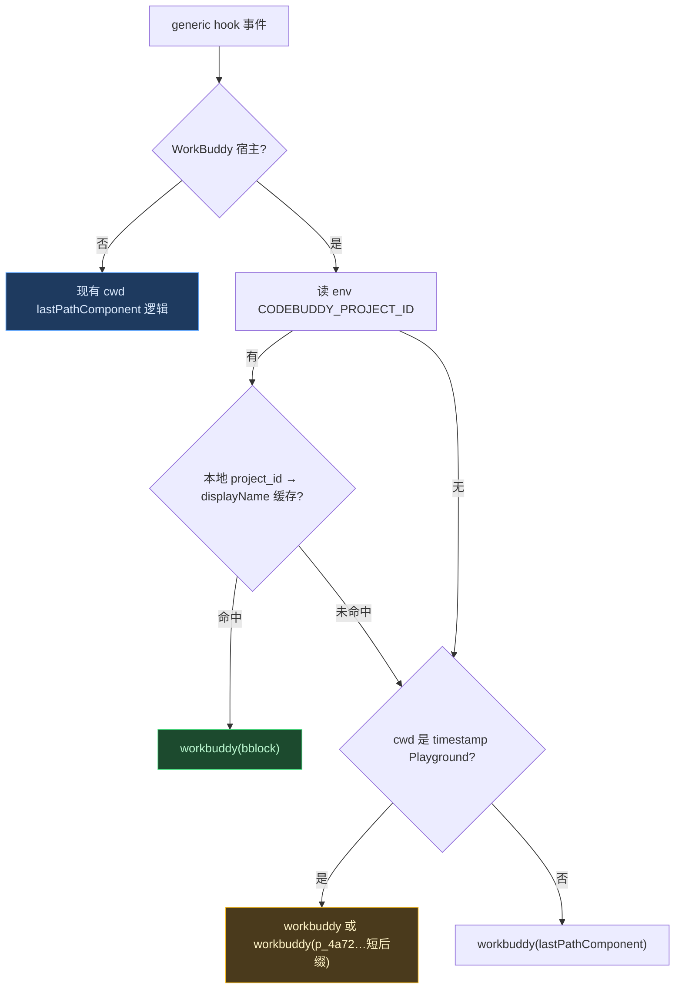

# WorkBuddy 展示标签推导策略对比

> Ticket: [#24 Which label derivation strategies are viable without upstream WorkBuddy changes?](https://github.com/yangxy112683/Agent-Signal-Bar/issues/24)  
> 前置：[#21 hook payload](./workbuddy-hook-payload-catalog.md) · [#22 用户偏好](https://github.com/yangxy112683/Agent-Signal-Bar/issues/22#issuecomment-5451766383) · [#23 workspace metadata](./workbuddy-workspace-metadata.md)  
> 目标格式：`workbuddy(bblock)`（工程空间 UI 名）

## 推荐结论

在**不改 WorkBuddy 上游**前提下，唯一能满足 [#22](https://github.com/yangxy112683/Agent-Signal-Bar/issues/22) 目标的方案是：

**分层标签解析（Tiered Resolver）**



| 层级 | 条件 | 标签 | 说明 |
|------|------|------|------|
| **L1** | `CODEBUDDY_PROJECT_ID` + 缓存命中 | `workbuddy(bblock)` | **主路径**，对齐 UI |
| **L2** | cwd 非 timestamp、有有意义目录名 | `workbuddy(esport_bb_lock)` | 直接打开本地仓库 |
| **L3** | Playground 且无缓存 | `workbuddy` 或 `workbuddy(p_4a72…)` | 避免无意义 timestamp |
| **禁止** | timestamp 作首选标签 | `workbuddy(2026-08-28-…)` | [#22 明确反例](https://github.com/yangxy112683/Agent-Signal-Bar/issues/22#issuecomment-5451766383) |

**缓存填充（v1 → v2）**

- **v1（立即可做）**：用户可编辑 `~/.agent-signal/workbuddy-project-names.json`
- **v2（增强）**：菜单栏 App 或 companion 脚本调用 WorkBuddy 本地 daemon（`wb:workspaces:getDisplayNames`）定期刷新缓存
- **v2 备选**：只读 `workbuddy.db` 无法得到 displayName，**不能**单靠 DB 完成 L1

---

## 策略对比表

| # | 策略 | 可行性 | 可靠性 | 复杂度 | 隐私/性能 | 满足 `workbuddy(bblock)` | 裁决 |
|---|------|--------|--------|--------|-----------|--------------------------|------|
| A | **现状** `cwd.lastPathComponent` | 高 | Playground 低 | 极低 | 优 | ❌ | 保留为非 Playground 的 L2 |
| B | timestamp 启发式（短日期 / 父路径片段） | 高 | 低 | 低 | 优 | ❌ | **否决**（仍是日期，非工程空间名） |
| C | `~/WorkBuddy/` 下向上找 `.git` / `package.json` / symlink | 中 | **极低** | 中 | 中（磁盘遍历） | ❌ | **否决** ([#23](docs/research/workbuddy-workspace-metadata.md) 实证目录为空) |
| D | hook 进程内 `git rev-parse --show-toplevel` | 中 | **极低** | 中 | 差（子进程） | ❌ | **否决**（cwd 固定为 Playground，git 在错误目录执行） |
| E | 解析 Bash `tool_input.command` 中的 `cd` 路径 | 中 | 低 | 高 | 中 | ⚠️ 偶发命中 | **仅调试**，不作产品逻辑 |
| F | 使用 payload 扩展字段 | — | — | — | — | ❌ | **否决** ([#21](docs/research/workbuddy-hook-payload-catalog.md) 无此类字段) |
| G | `sessions.title` / AI 会话标题 | 高 | 低 | 低 | 优 | ❌ | **否决**（每会话不同，非工程空间名） |
| H | **`CODEBUDDY_PROJECT_ID` + 本地 displayName 缓存** | 高 | **高**（缓存命中后） | 中 | 优（本地读） | ✅ | **推荐 L1** |
| I | 读 `workbuddy.db` 直接取展示名 | 中 | **无** | 中 | 中 | ❌ | **否决**（DB 无 name 列） |
| J | hook 内调云端 Teams API | 低 | 中 | 高 | 差（网络+鉴权） | ⚠️ | **defer v2+**（维护成本高） |
| K | 用户 env `AGENT_SIGNAL_WORKBUDDY_LABEL` | 高 | 高 | 极低 | 优 | ✅ | **补充**（单用户 override，非默认） |

---

## 各策略详评

### A. `lastPathComponent`（现状）

- **Playground**：`workbuddy(2026-08-28-19-04-08)` — 用户不可接受
- **直接开仓库**：`workbuddy(esport_bb_lock)` — 可接受，但与 `bblock` 不一致时仍错
- **保留为 L2**：仅当无 `project_id` 且 cwd 不是 timestamp 时使用

### B. Timestamp 启发式降级

例如识别 `^\d{4}-\d{2}-\d{2}(-\d{2}-\d{2}-\d{2})?$` 后显示 `workbuddy` 或 `08-28`。

- 比完整 timestamp 好一点，但**仍不是**工程空间名
- [#22](https://github.com/yangxy112683/Agent-Signal-Bar/issues/22#issuecomment-5451766383) 要求的是 `bblock`，不是短日期
- 可作为 **L3 兜底**，不能替代 L1

### C / D. 文件系统与 Git 探测

[#23](docs/research/workbuddy-workspace-metadata.md) 已证：

- Playground 目录**空**或仅 `.workbuddy/memory/`
- 无 symlink、无 `.git`
- hook `cwd` **不随** Bash `cd` 变化

因此 C、D 对主场景无效。

### E. 解析 Bash 命令

实证：用户 `cd ~/work/esport_bb_lock` 时 payload.cwd 仍为 Playground。

- 可作为开发期验证线索
- 多会话、非 Bash 工具、路径带空格时不可靠
- **不进入 GenericHookAdapter 主路径**

### F. Payload 扩展字段

[#21](docs/research/workbuddy-hook-payload-catalog.md)：payload 仅有 `cwd`、`session_id`、`client` 等；**无** `project_id` / `workspace_name`。

环境变量 `CODEBUDDY_PROJECT_ID` 是唯一稳定的项目级键。

### H. `project_id` + 本地缓存（推荐）

**解析链**

```
hook env CODEBUDDY_PROJECT_ID
  → ~/.agent-signal/workbuddy-project-names.json[p_id]
  → displayName "bblock"
  → agentName = "workbuddy(bblock)"
```

**建议缓存格式**

```json
{
  "version": 1,
  "updatedAt": "2026-08-28T19:30:00Z",
  "projects": {
    "p_4a72e62b48154560a5ce37551dbb4a9b": {
      "displayName": "bblock"
    }
  }
}
```

**sessionKey 建议**（与展示名对齐，减少 timestamp 碎片）：

- 有 `project_id`：`workbuddy:<project_id>` 或 `workbuddy:<displayName>`
- 无 `project_id`：保留现有 `workbuddy:<cwd.lastPathComponent>`

**v2 自动填充**：研究 `wb:workspaces:getDisplayNames`（daemon.log 有调用）是否可通过本地 IPC/HTTP 由菜单栏 App 拉取并写缓存——**不在 hook 热路径调网络**。

### K. 环境变量 Override

`AGENT_SIGNAL_WORKBUDDY_LABEL=bblock` 供高级用户或测试使用；不解决默认用户体验。

---

## 与 #22 偏好的对齐

| 用户要求 | 策略映射 |
|----------|----------|
| 标签 = 左侧面板工程空间名 | **H（缓存）** |
| 不要 timestamp | L3 禁止 lastPathComponent；L1 优先 |
| `bblock` 优先于 `esport_bb_lock` | 有 project_id 时**不看** cwd 目录名 |
| 拿不到工程空间名才降级 | L2 → L3 顺序 |

---

## 实现触点（供 #25 / #26，本文不实现）

| 模块 | 改动要点 |
|------|----------|
| `GenericHookAdapter.agentName` | WorkBuddy 分支：先 `project_id` → 缓存 → 再 cwd 规则 |
| `GenericHookAdapter.sessionKey` | `workbuddyProjectSessionKey` 改为优先 `project_id` |
| 新 `WorkBuddyProjectNameCache` | 读 `~/.agent-signal/workbuddy-project-names.json`，内存缓存 + mtime |
| `install_hooks` / 文档 | 说明如何填写缓存；v2 增加 sync 命令 |
| 测试 | Playground+缓存、Playground+无缓存、本地仓库、无 project_id |

---

## 对抗式审查（10 条）

| # | 场景 | 期望 agentName |
|---|------|----------------|
| 1 | Playground + project_id + 缓存 `bblock` | `workbuddy(bblock)` |
| 2 | Playground + project_id + 无缓存 | `workbuddy` 或 `workbuddy(p_4a72…)`，**非** timestamp |
| 3 | cwd=`~/work/esport_bb_lock` + 缓存 `bblock` | `workbuddy(bblock)`（project_id 优先） |
| 4 | cwd=`~/work/esport_bb_lock` + 无 project_id | `workbuddy(esport_bb_lock)` |
| 5 | cwd=`~/WorkBuddy/Claw` + 无 project_id | `workbuddy(claw)` |
| 6 | `__workbuddy_cli_host__` | 忽略 / 无标签 |
| 7 | 缓存文件损坏 JSON | 降级 L2/L3，不 crash |
| 8 | project_id 变更、缓存陈旧 | 显示旧名直至 refresh（可接受 v1） |
| 9 | 两会话同 project_id | 同 sessionKey（若按 project_id） |
| 10 | 非 WorkBuddy 宿主 | 不受影响 |

---

## 明确否决项（写入 #26 约束）

1. 不以 timestamp 目录名作为**首选**标签  
2. 不在 hook 热路径执行 `git` / 网络请求  
3. 不把 `sessions.title` 当工程空间名  
4. 不依赖 Bash 命令解析作默认逻辑  
