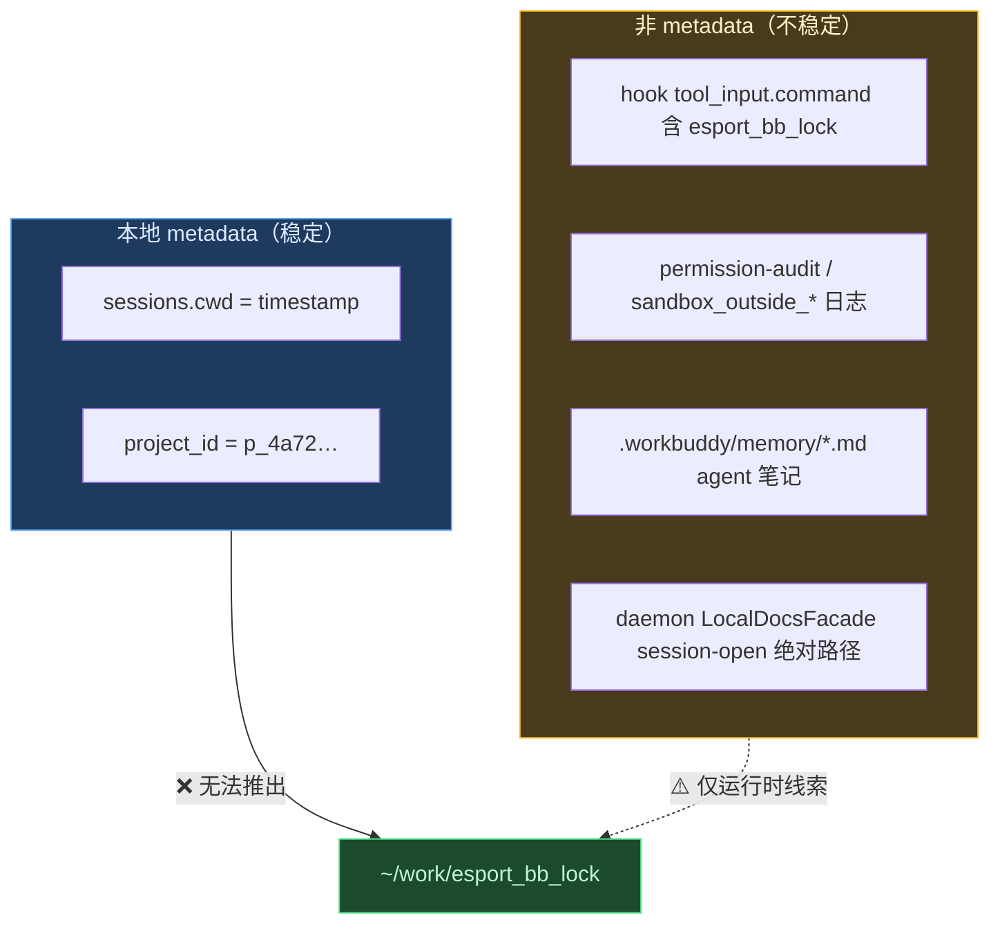

# WorkBuddy 工作区 Metadata 调研

> Ticket: [#23 Does WorkBuddy workspace metadata expose a linked project path?](https://github.com/yangxy112683/Agent-Signal-Bar/issues/23)  
> 前置：[#21 Hook payload 调研](./workbuddy-hook-payload-catalog.md)  
> 环境：WorkBuddy 5.4.4 / macOS / 2026-08-28

## 结论（一句话）

**不能。** Timestamp Playground 工作区（`~/WorkBuddy/2026-08-28-*`）在本地 metadata 中**没有**指向真实仓库路径（如 `~/work/esport_bb_lock`）的稳定字段；工程空间展示名（如 `bblock`）也不在本地明文落盘。

---

## 能力矩阵

| 能否推断 | 目标 | 结论 |
|----------|------|------|
| ❌ | timestamp cwd → 真实 git 仓库路径 | 无 symlink / `.git` / 配置文件映射 |
| ⚠️ | timestamp cwd → Teams `project_id` | 经 `workbuddy.db.sessions` 或 hook env 可查，但非工作区目录内 metadata |
| ❌ | `project_id` → 左侧面板展示名 `bblock` | 本地无明文；疑似 `wb:workspaces:getDisplayNames` 云端 |
| ⚠️ | 会话 → 曾访问的外部路径 | 仅出现在日志 / transcript / agent memory，非结构化、不可靠 |

---

## 调查范围与发现

### 1. 工作区目录本体（`~/WorkBuddy/<timestamp>/`）

**典型 Playground 目录（2026-08-28 批次）**

```
~/WorkBuddy/2026-08-28-19-04-08/     # 完全空目录
~/WorkBuddy/2026-08-28-15-45-43/
  └── .workbuddy/
        └── memory/
              └── 2026-08-28.md      # agent 写入的笔记，非系统 metadata
```

| 检查项 | 结果 |
|--------|------|
| symlink 指向外部仓库 | **无** |
| `.git` | **无** |
| `workspace.json` / `config.json` | **无** |
| `.workbuddy/` 内除 memory 外文件 | **无** |
| 根目录配置文件列出 linked path | **无** |

**对照：有内容的老工作区**（`2026-08-06-17-20-19`）

- 用户产物直接落在 timestamp 目录下（如 `AI-native落地效果评估/`）
- 仍是「sandbox 内创作」，不是对外部仓库的链接

### 2. `~/.workbuddy/app/sessions.json`

```json
{
  "conversationId": "4ac1e0d0-5f0f-4720-8225-d608bdaaaad3",
  "workDir": "/Users/dawn80s/WorkBuddy/2026-08-28-19-04-08"
}
```

仅 `workDir` = timestamp 路径，**无** `projectId`、**无** `linkedRepo`。

### 3. `~/.workbuddy/workbuddy.db`

**`sessions` 表（Playground + Teams 工程空间）**

| 字段 | 示例 | 说明 |
|------|------|------|
| `cwd` | `/Users/dawn80s/WorkBuddy/2026-08-28-19-04-08` | 同 hook payload |
| `project_id` | `p_4a72e62b48154560a5ce37551dbb4a9b` | Teams 工程空间 ID |
| `is_playground` | `1` | Playground 标记 |
| `title` | `补充全过程记录文档内容` | **会话标题**，非工程空间名 |

**`workspaces` 表**

```sql
CREATE TABLE workspaces (path TEXT PRIMARY KEY, last_opened_at INTEGER);
-- 例：/Users/dawn80s/WorkBuddy/Claw
```

只有「最近打开的路径」，无 display name、无 repo 链接。

### 4. Sandbox 会话目录

`~/.workbuddy/workspace/sessions/<session_id>/`

- 含 `snapfile/` 等沙箱状态
- **无** JSON 记录外部仓库路径

### 5. `sessions/<pid>.json`（CLI 进程快照）

```json
{
  "sessionId": "4ac1e0d0-…",
  "cwd": "/Users/dawn80s/WorkBuddy/2026-08-28-19-04-08"
}
```

同 timestamp cwd，无扩展 metadata。

### 6. 与 #21 交叉验证：真实路径出现在哪？

用户在同一会话中操作 `~/work/esport_bb_lock`，但 **cwd 始终为 Playground**：



**实证路径（证据清单）**

| 证据 | 路径 | 内容 |
|------|------|------|
| Hook capture | `/tmp/workbuddy-hook-capture.jsonl` | Bash `cd …/esport_bb_lock` |
| 权限审计 | `~/.workbuddy/logs/main.log` | `sandbox_outside_*` + command |
| 文档打开 | `~/.workbuddy/logs/daemon.log` | `session-open` → `.scratch/…/全过程记录….docx` |
| Agent memory | `~/WorkBuddy/…/15-45-43/.workbuddy/memory/2026-08-28.md` | 手写提及 esport_bb_lock |
| Transcript | `~/.workbuddy/projects/Users-dawn80s-WorkBuddy-…/session.jsonl` | `@` 引用、Bash 参数 |

### 7. 工程空间展示名（`bblock`）

| 来源 | 结果 |
|------|------|
| `workbuddy.db` strings | 无 `bblock` |
| `~/.workbuddy/local_storage/*.info` | 无 project display map |
| Electron LevelDB | 无 `bblock` / `p_4a72` 明文 |
| `edge-sync.log` | `CREATE` body 含 `workDir` + `isPlayground`，Teams 会话为 `CREATE_SKIP_PID` + `projectId` |
| `daemon.log` | `wb:workspaces:getDisplayNames` 有调用，**响应未落盘** |

---

## 与 #21 的对照表

| 场景 | hook `cwd` | metadata 能否补全真实路径 | metadata 能否给展示名 |
|------|------------|---------------------------|----------------------|
| Playground + Teams 工程空间 | timestamp | ❌ | ❌（需 project_id → 云端名） |
| 直接打开本地目录 | `~/work/esport_bb_lock` | ✅（cwd 即路径） | ⚠️（lastPathComponent 可用） |
| Playground 无 project_id | timestamp | ❌ | ❌ |

---

## 对 #24 可行策略的启示

1. **不要指望**从 `~/WorkBuddy/<timestamp>/.workbuddy/` 或工作区目录结构反推仓库路径。
2. **可用稳定键**：hook env `CODEBUDDY_PROJECT_ID` + `workbuddy.db` 只读查询（按 `session_id` 或 `project_id`）。
3. **展示名 `bblock`** 需单独解决：缓存 `getDisplayNames` 结果、或维护 `project_id → displayName` 本地映射文件。
4. **不可靠降级**：解析 Bash `cd`、@ 文件路径 — 仅作调试，不作产品逻辑。

---

## 对抗式审查（10 条用例）

| # | 输入 | 问：metadata 能推出真实路径？ | 预期 |
|---|------|------------------------------|------|
| 1 | `~/WorkBuddy/2026-08-28-19-04-08` 空目录 | 查目录内文件 | ❌ |
| 2 | 同上 + `sessions.project_id` | 查 DB | ❌ 只有 ID，无路径 |
| 3 | 同上 + `.workbuddy/memory/*.md` | 读 agent 笔记 | ⚠️ 可能有提及，非系统字段 |
| 4 | `app/sessions.json` workDir | 读 JSON | ❌ 仅 timestamp |
| 5 | `workspaces` 表 | SQL | ❌ 仅最近路径列表 |
| 6 | sandbox `workspace/sessions/<id>/` | 列目录 | ❌ 无 repo 映射 |
| 7 | 用户 Bash cd 外部仓库 | 读 hook payload | ⚠️ 运行时线索，非 metadata |
| 8 | `project_id` → `bblock` | 本地全文搜索 | ❌ |
| 9 | 直接打开 `~/work/esport_bb_lock` | cwd | ✅ cwd 即路径 |
| 10 | Claw 工作区 `~/WorkBuddy/Claw` | workspaces 表 | ⚠️ 路径有意义，但是另一类工作区 |

---

## 证据路径清单

- `~/WorkBuddy/2026-08-28-{10-35,15-45,17-33,18-38,19-04}-08/` — 目录结构
- `~/.workbuddy/app/sessions.json`
- `~/.workbuddy/workbuddy.db` — `sessions`, `workspaces`
- `~/.workbuddy/sessions/72410.json`
- `~/.workbuddy/workspace/sessions/4ac1e0d0-…/`
- `~/.workbuddy/logs/2026-08-28/edge-sync.log` — CREATE / CREATE_SKIP_PID
- `~/.workbuddy/logs/main.log` — permission-audit 外部路径
- `~/.workbuddy/logs/daemon.log` — getDisplayNames、LocalDocsFacade
- `docs/research/workbuddy-hook-payload-catalog.md` — hook 侧结论
